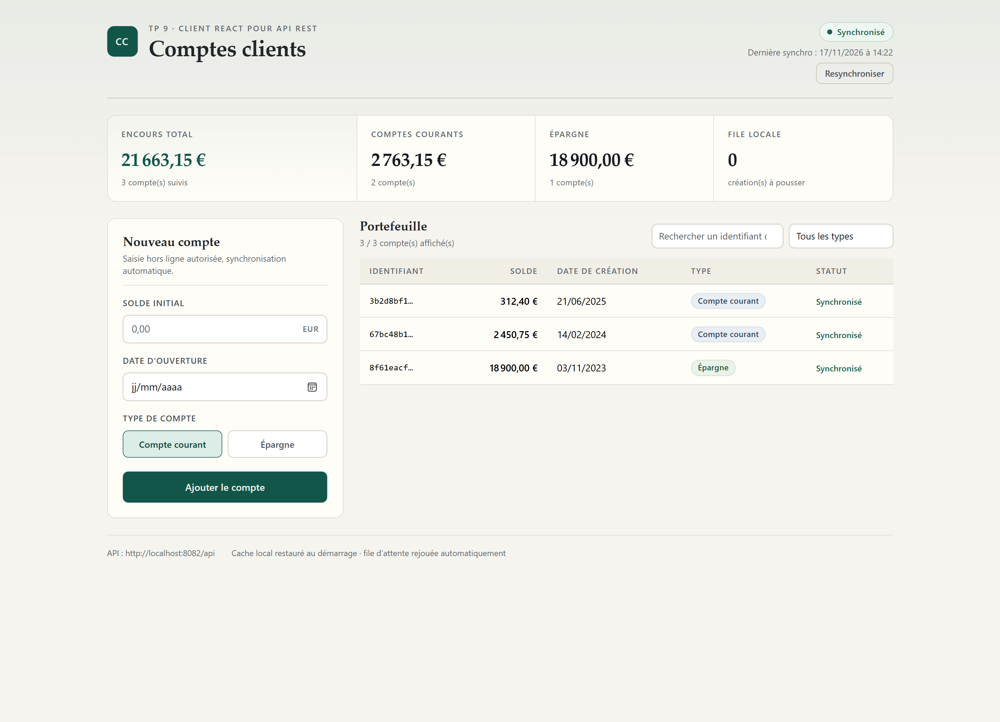
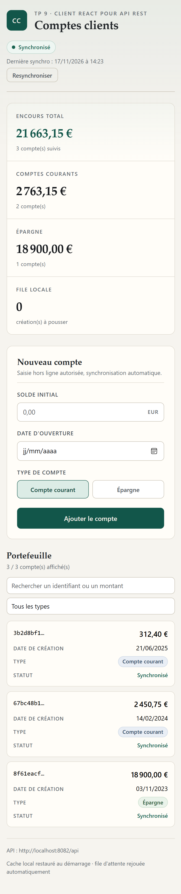
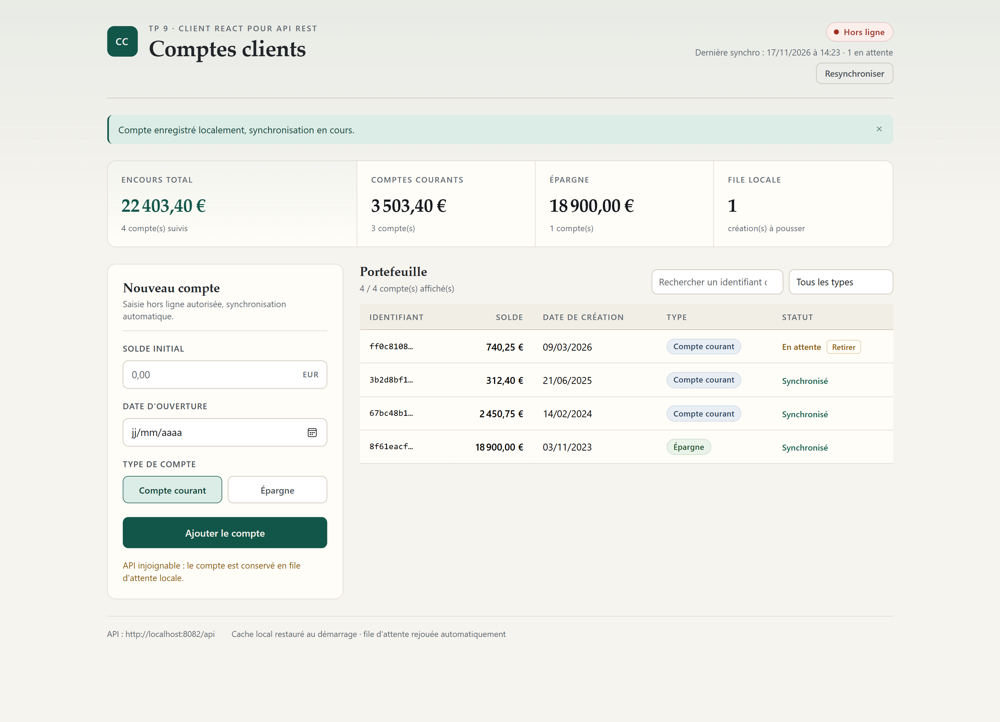
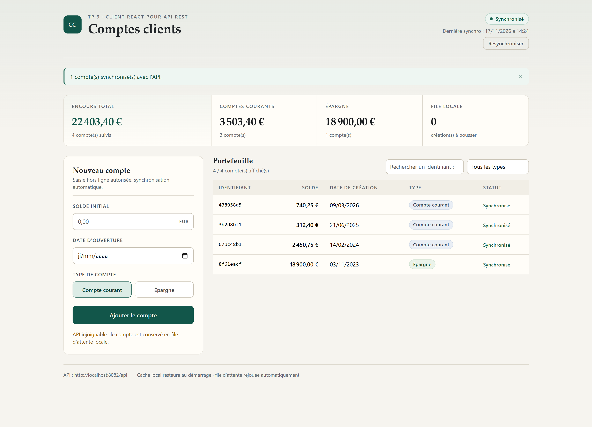
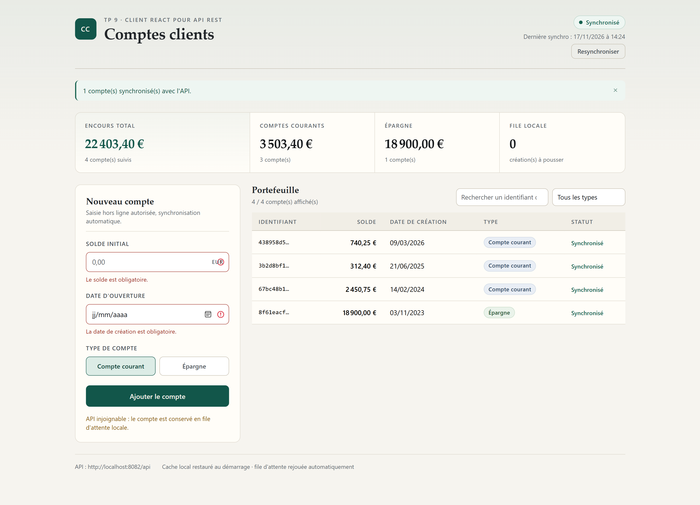
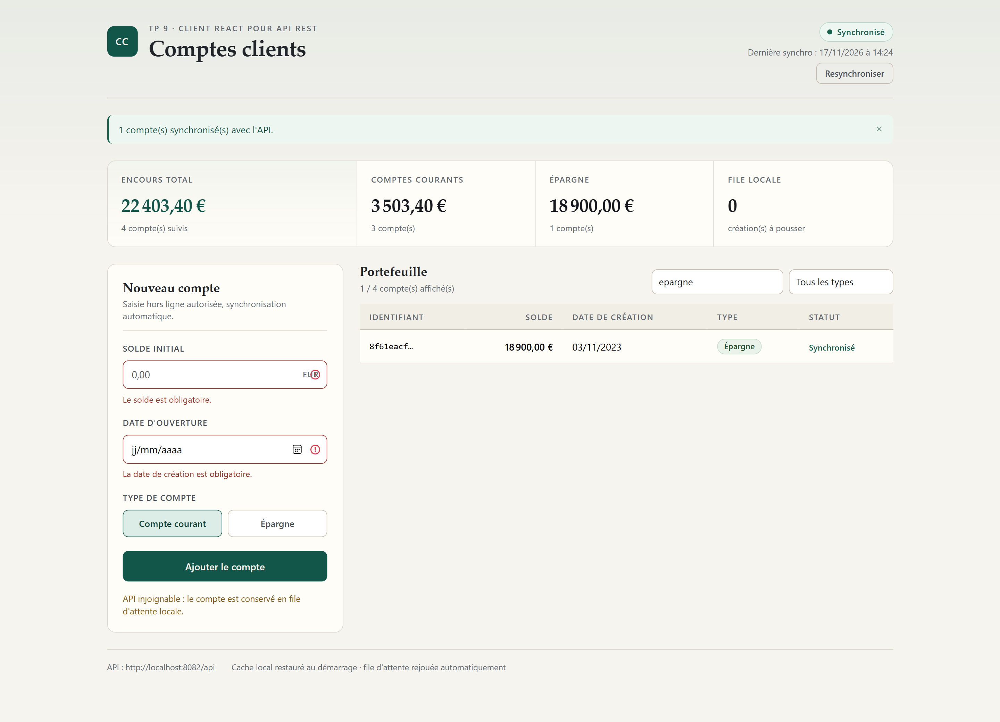
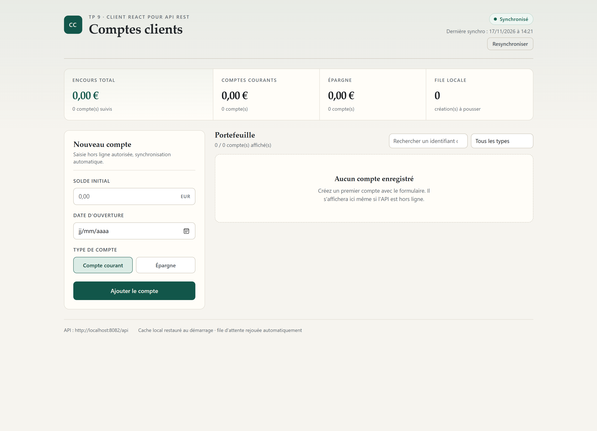
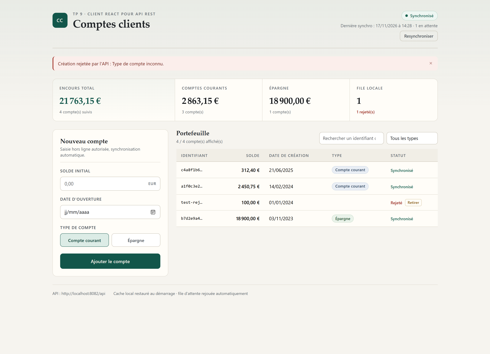

# TP 9 - Client React pour API REST

## Tableau de bord

## Vue mobile

## Mode hors ligne et file d attente

## Synchronisation reussie

## Validation du formulaire

## Recherche et filtre

## Etat vide

## Rejet metier par l API

